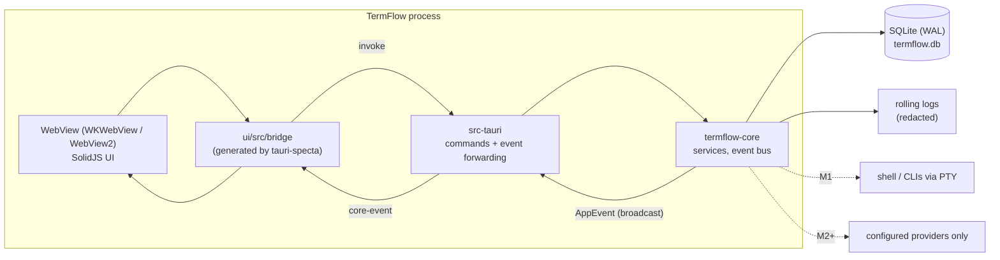
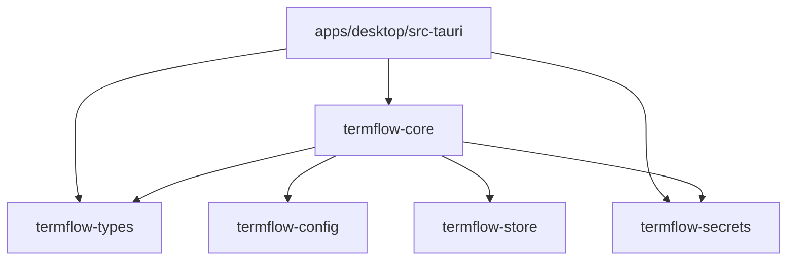
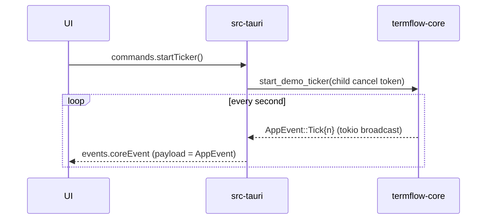
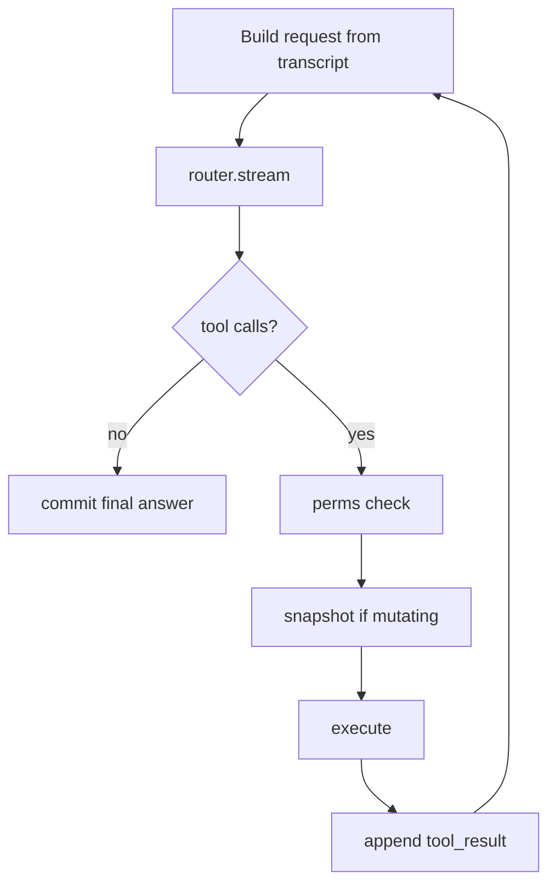
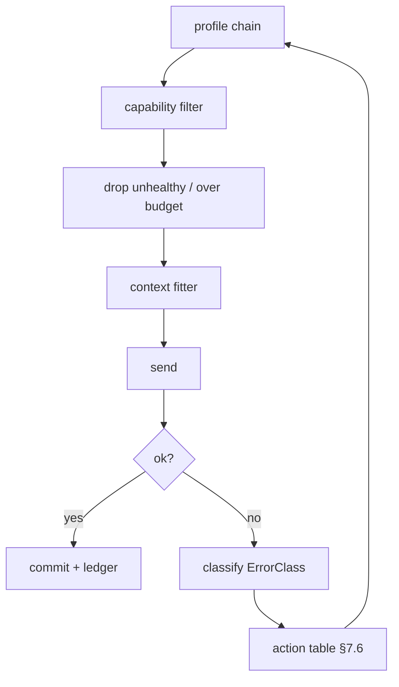

# Architecture

Spec: `docs/BUILD_PROMPT.md`. This file describes what exists; sections marked *planned* are design, not code.

## Process model

The core runs in-process (no sidecar). Core crates never depend on Tauri, so the shell can be swapped (Electron, GPUI).

## Crate dependency graph (M0)

Planned (M2–M3): `agent → router → providers → types`, `agent → tools → perms, snapshots`, `router → catalog, store`.

## Event bus

All events are `termflow_types::AppEvent`; the UI narrows on `type`. Persistence rule (M2+): a transcript event is committed to SQLite before it is published.

## Storage

One writer thread owns the write connection; callers send closures and await the result (`Store::write`). Reads use separate read-only connections. Migrations: `crates/termflow-store/migrations/`, applied with `rusqlite_migration` (`user_version`).

## Agent loop — *planned (M2)*

## Router decision flow — *planned (M3)*

## Data model

See `crates/termflow-store/migrations/0001_init.sql` (tables from BUILD_PROMPT §13; health, rate_limits, budgets, snapshots, catalog_models and permissions_log arrive with their milestones).
